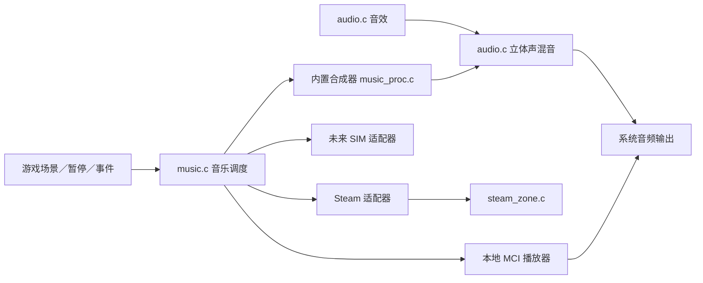

# CANITY 音乐模块与接口协议 v1

游戏源码里有三个相关模块：调度层 `src/music.c`、内置合成器 `src/music_proc.c`、音效与混音 `src/audio.c`。调度层独立于音效合成，也独立于 Steam API 实现。

默认不需要任何音乐文件：内置程序化配乐直接合成 4 首恐怖氛围曲，按场景自动切换。想换曲子时再放文件，文件优先于内置曲目。

## 以后放入音乐的方法

在 `canity.exe` 旁新建 `music` 文件夹。支持以下文件名，优先读取 MP3，同名 MP3 不存在时读取 WAV：

| 文件名 | 场景 |
|---|---|
| `menu.mp3` / `menu.wav` | 主菜单 |
| `explore.mp3` / `explore.wav` | 探索 |
| `chase.mp3` / `chase.wav` | 猎手追逐 |
| `safe.mp3` / `safe.wav` | 商店／安全屋界面 |
| `victory.mp3` / `victory.wav` | 成功撤离 |
| `defeat.mp3` / `defeat.wav` | 失败 |

可只放一部分文件。只要 `music/` 里有任意一个能识别的文件，就整体切回文件模式，缺少文件的场景保持安静；想保留内置曲目就清空 `music/` 或设置 `CANITY_MUSIC=builtin`。解码由 Windows MCI 提供，具体文件能否播放取决于其编码格式与本机解码支持。

## 内置程序化配乐（默认）

`src/music_proc.c` 移植自 `canity-music/horror3.c` 的合成引擎，四个 composer 的音符数据保持原样。它不生成 WAV、不读文件，而是在音频线程里按 1024 帧一块实时合成，输出 22050Hz 立体声交给 `audio.c` 统一混音。

| 场景 | 内置曲目 | 说明 |
|---|---|---|
| 主菜单 | Lull | 音乐盒开场，逐渐走调 |
| 探索 | Hollow | A 小调两段式和弦，旋律不规整 |
| 追逐 | Fracture | E 小调，4 秒和弦推进 |
| 商店／安全屋 | Crawl | 深海 drone，压力最低 |
| 成功撤离 | 静音 | 只留音效，避免结算界面音乐压过提示音 |
| 失败 | 静音 | 只留音效 |

所有曲目都是无缝续写的：每一圈的音符带绝对时间，上一圈结尾的长音会自然盖进下一圈开头，而不是在圈尾截断，所以循环处没有接缝，也不需要交叉淡化。场景切换先淡出 0.8 秒，再重置合成器并淡入 1.2 秒；暂停和压低音量由 `MusicTick` 的增益平滑统一处理。

`CANITY_MUSIC=builtin` 可强制只用内置曲目，`CANITY_MUSIC=files` 可强制只用 `music/` 里的文件（缺文件的场景保持安静）。

## 模块协议



统一接口：

- `MusicSetScene`：主菜单、探索、追逐、安全、胜利、失败。
- `MusicSetTrack`：为场景设置 UTF-8 文件路径。
- `MusicSetMasterVolume`：音量范围 0～1。
- `MusicSetPaused`：暂停／恢复，已接游戏暂停和最小化。
- `MusicDuck`：限时降低音乐音量，恢复时平滑回升。
- `MusicNotify`：出口、被抓、成就等重要事件。
- `MusicTick`、`MusicShutdown`：每帧更新和资源释放，已接主循环。

本地文件曲目会循环播放；内置曲目会无缝续写。重要事件可以降低音乐音量，为提示音留空间。

内置配乐是 `MUSIC_BUILTIN` provider（编号追加在枚举末尾，旧编号不变）。真正的声音在音频线程生成，主线程与音频线程之间只通过两个原子变量（场景、增益）交接，不持有 `audio.c` 的混音锁，也不会在音频线程回调里重入 `Music*`。

## 接入 SIM

`MusicProvider` 是版本化回调表；当前协议号为 `MUSIC_PROTOCOL_VERSION = 1`。实现 `play`、`stop`，按需提供 `pause`、`gain`、`scene`、`tick`，注册后启用：

```c
MusicProvider adapter = {
    MUSIC_PROTOCOL_VERSION,
    SimMusicPlay, SimMusicStop,
    SimMusicPause, SimMusicGain,
    SimMusicScene, SimMusicTick
};
MusicRegisterProvider(MUSIC_SIM, &adapter, simContext);
MusicUseProvider(MUSIC_SIM);
```

这里的 `SimMusic*` 是未来 SIM 系统实现的函数，本次不假定 SIM 的内部技术。未注册或协议不兼容时，启用会失败，现有播放源保持可用。自动测试已用模拟 SIM 适配器验证播放、场景、音量、压低恢复、暂停恢复及关闭。

回调均在主线程执行，不得阻塞，也不得在回调里重新进入 `Music*` 调度接口。适配器管理自己的解码资源；音乐模块管理场景、音量和暂停状态。

## Steam 的边界

Steam 专区仍是唯一直接操作 Steam API 的模块。音乐模块通过它的封装使用 Steam 播放器，只有先前正在播放的音乐才会被临时暂停；恢复只针对本模块造成的暂停。

本地版默认不启用 Steam，不要求安装 Steam 或携带 Steam DLL。Steam 线上联调还需要对应 App ID、运行库和后台成就／云存档配置。不能把本地接口测试当成 Steam 线上验收。

参考：[Microsoft MCI 播放命令](https://learn.microsoft.com/en-us/windows/win32/multimedia/play)、[MCI 音量命令](https://learn.microsoft.com/en-us/windows/win32/multimedia/setaudio)、[Steam 成就接口](https://partner.steamgames.com/doc/api/ISteamUserStats)、[Steam Cloud](https://partner.steamgames.com/doc/features/cloud)。
