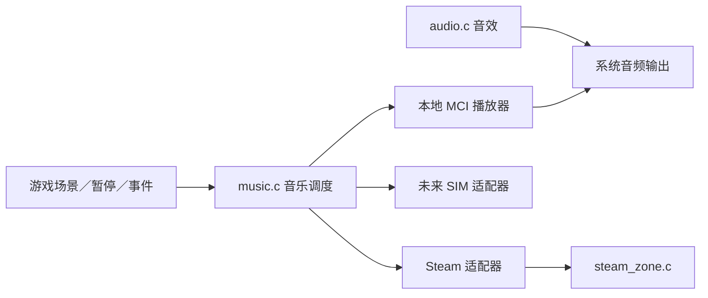

# CANITY 音乐模块与接口协议 v1

游戏源码新增 `include/music.h` 与 `src/music.c`，已接入主循环。它独立于音效合成模块 `audio.c`，也独立于 Steam API 实现。

## 以后放入音乐的方法

在 `canity.exe` 旁新建 `music` 文件夹。支持以下文件名，优先读取 MP3，同名 MP3 不存在时读取 WAV：

| 文件名 | 场景 |
|---|---|
| `menu.mp3` / `menu.wav` | 主菜单 |
| `explore.mp3` / `explore.wav` | 探索 |
| `chase.mp3` / `chase.wav` | 猎手追逐 |
| `safe.mp3` / `safe.wav` | 商店／安全屋界面 |
| `victory.mp3` / `victory.wav` | 成功撤离 |
| `defeat.mp3` / `defeat.wav` | 失败 |

可以只放一部分。没有音乐文件时保持安静，游戏正常运行。本次没有附带歌曲，也没有更改你已有的音效设计。解码由 Windows MCI 提供，具体文件能否播放取决于其编码格式与本机解码支持。

## 模块协议



统一接口：

- `MusicSetScene`：主菜单、探索、追逐、安全、胜利、失败。
- `MusicSetTrack`：为场景设置 UTF-8 文件路径。
- `MusicSetMasterVolume`：音量范围 0～1。
- `MusicSetPaused`：暂停／恢复，已接游戏暂停和最小化。
- `MusicDuck`：限时降低音乐音量，恢复时平滑回升。
- `MusicNotify`：出口、被抓、成就等重要事件。
- `MusicTick`、`MusicShutdown`：每帧更新和资源释放，已接主循环。

本地音乐的场景曲目会循环播放。重要事件可以降低音乐音量，为提示音留空间。

## 接入 SIM

`MusicProvider` 是版本化回调表；当前协议号为 `MUSIC_PROTOCOL_VERSION = 1`。实现 `play`、`stop`，按需提供 `pause`、`gain`、`scene`、`tick`，注册后启用：

```c
MusicProvider adapter = {
    MUSIC_PROTOCOL_VERSION,
    SimMusicPlay, SimMusicStop,
    SimMusicPause, SimMusicGain,
    SimMusicScene, SimMusicTick
};
MusicRegisterProvider(MUSIC_SIM, &adapter, simContext);
MusicUseProvider(MUSIC_SIM);
```

这里的 `SimMusic*` 是未来 SIM 系统实现的函数，本次不假定 SIM 的内部技术。未注册或协议不兼容时，启用会失败，现有播放源保持可用。自动测试已用模拟 SIM 适配器验证播放、场景、音量、压低恢复、暂停恢复及关闭。

回调均在主线程执行，不得阻塞，也不得在回调里重新进入 `Music*` 调度接口。适配器管理自己的解码资源；音乐模块管理场景、音量和暂停状态。

## Steam 的边界

Steam 专区仍是唯一直接操作 Steam API 的模块。音乐模块通过它的封装使用 Steam 播放器，只有先前正在播放的音乐才会被临时暂停；恢复只针对本模块造成的暂停。

本地版默认不启用 Steam，不要求安装 Steam 或携带 Steam DLL。Steam 线上联调还需要对应 App ID、运行库和后台成就／云存档配置。不能把本地接口测试当成 Steam 线上验收。

参考：[Microsoft MCI 播放命令](https://learn.microsoft.com/en-us/windows/win32/multimedia/play)、[MCI 音量命令](https://learn.microsoft.com/en-us/windows/win32/multimedia/setaudio)、[Steam 成就接口](https://partner.steamgames.com/doc/api/ISteamUserStats)、[Steam Cloud](https://partner.steamgames.com/doc/features/cloud)。
